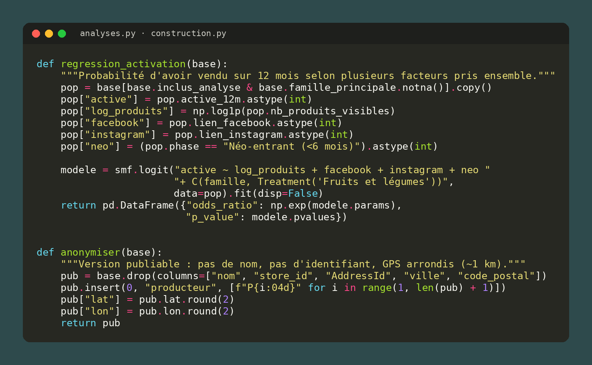
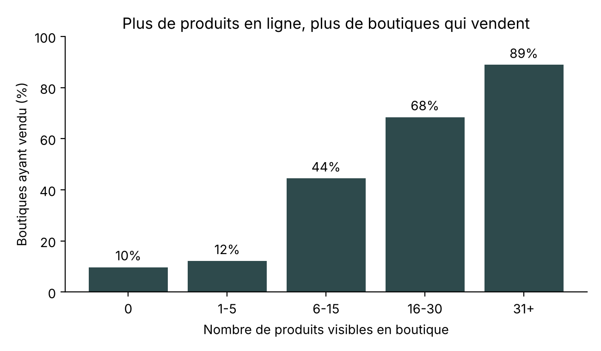
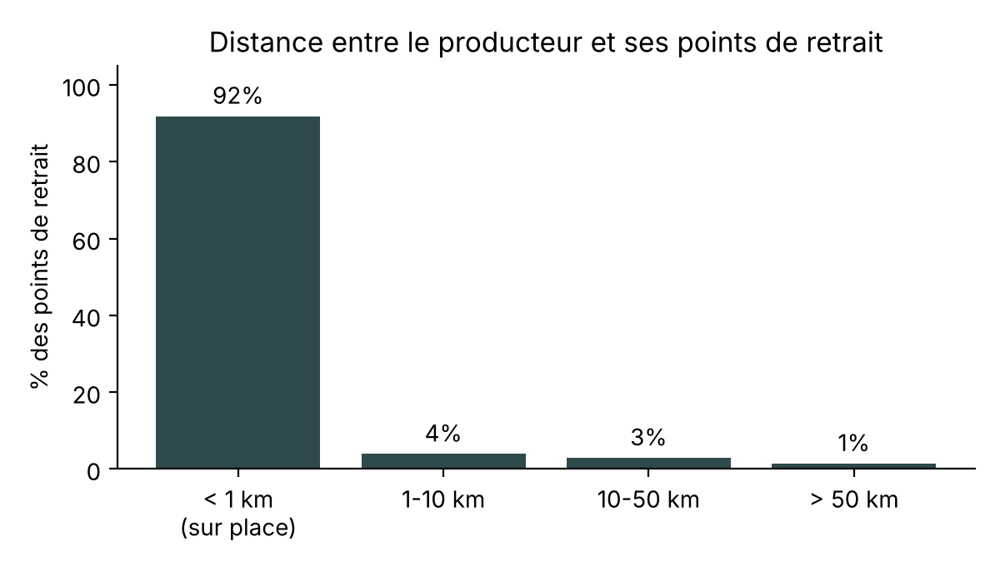
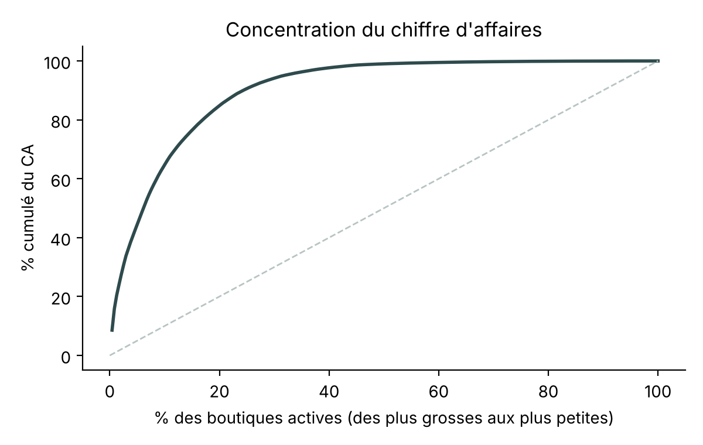
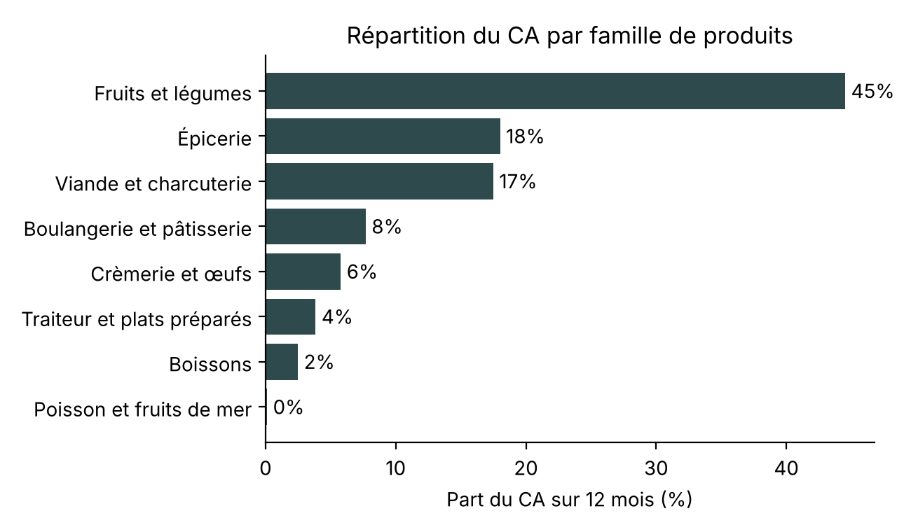
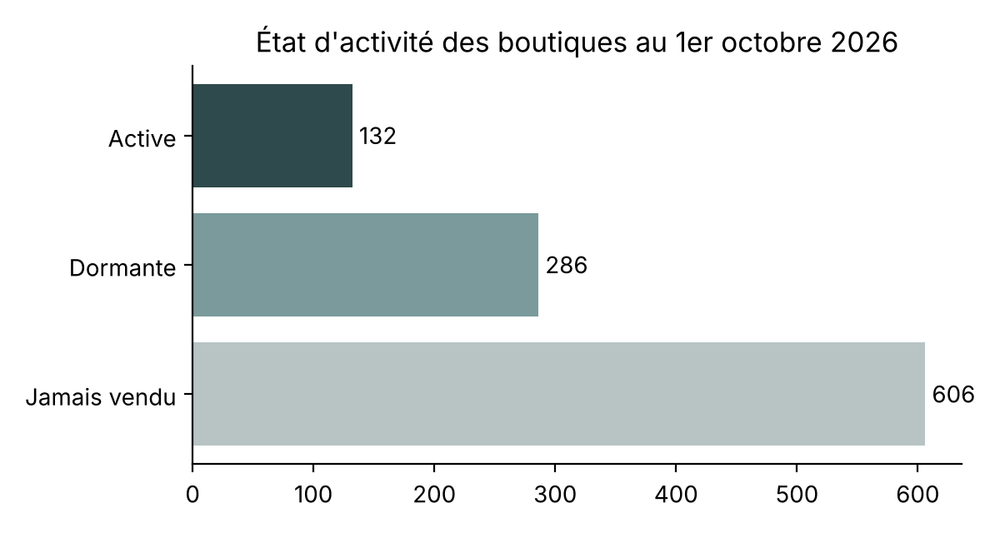
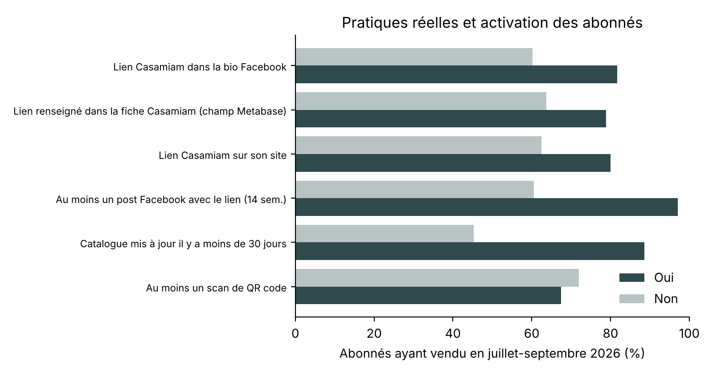

# Performance et impact des producteurs en circuit court

**Analyse de données menée pendant mon alternance chez [Casamiam](https://www.casamiam.fr), start-up de l'économie sociale et solidaire qui permet aux producteurs locaux de vendre en ligne et de faire retirer les commandes sur place.**

Python · pandas · statsmodels · matplotlib · folium



## Questions

1. Quelles pratiques sont associées à la réussite des boutiques de producteurs ?
2. Quel impact territorial le circuit court génère-t-il ?

## Méthode mixte

- **Quantitatif** : plus de 1 000 boutiques et 27 000 commandes depuis 2021, à partir de 7 exports de la base de données (ventes, produits, catégories, adresses, points de retrait). Période d'analyse : octobre 2025 – septembre 2026.
- **Qualitatif** : entretiens semi-directifs avec des producteurs, choisis par tirage aléatoire stratifié (actifs, dormants, jamais vendu) pour éviter le biais du survivant.
- **Volet complémentaire** : suivi hebdomadaire des pratiques réelles de 157 producteurs abonnés (catalogue, réseaux sociaux, QR codes) pendant 15 semaines.

Modèles utilisés : comparaisons de groupes, régression logistique (activation), modèles à effets fixes intra-producteur (ventes mensuelles), corrélations de Spearman.

## Principaux résultats

| Indicateur | Valeur |
|---|---|
| Boutiques ayant vendu sur 12 mois | 23 % |
| Part du chiffre d'affaires réalisée par les 20 premières boutiques | 60 % |
| Points de retrait à moins de 1 km du producteur | 91 % |
| Boutiques ayant déjà vendu et aujourd'hui dormantes | 68 % |

- **Le nombre de produits en ligne est le facteur le plus associé à l'activation** : 10 % des boutiques sans produit visible ont vendu, contre 89 % de celles qui en ont plus de 30.
- **À nombre de produits égal, renseigner ses réseaux sociaux n'est plus significatif** (régression logistique). Les entretiens nuancent : la relation directe (marché, email) compte souvent plus.
- **Un catalogue à jour va avec les ventes** : 89 % des abonnés dont le catalogue a moins de 30 jours ont vendu, contre 45 % des autres.
- **Publier le lien compte plus que l'afficher** : pour un même producteur, les mois avec un post contenant le lien comptent environ 70 % de commandes en plus.
- **Le circuit court au sens strict** : les commandes sont retirées chez le producteur, sans logistique intermédiaire.

Ce sont des associations, pas des causalités : un producteur qui vend a aussi plus de raisons de mettre son catalogue à jour.

| | |
|---|---|
|  |  |
|  |  |
|  |  |

Le projet produit aussi une **carte interactive** des producteurs actifs (folium), anonymisée : aucun nom, positions arrondies à environ 1 km, chiffre d'affaires en tranches.

## Tester le projet

Les données réelles sont internes à Casamiam et ne sont pas publiées. Un générateur crée des exports **fictifs** au même format pour faire tourner toute la chaîne :

```bash
pip install -r requirements.txt
python demo/generer_donnees_fictives.py   # crée des données fictives dans data/raw
python main.py                            # analyses, graphiques, carte et rapport dans outputs/
```

Avec les données fictives, les chiffres obtenus n'ont évidemment rien à voir avec ceux ci-dessus.

## Structure

```
config.py          paramètres : période, seuils, familles de produits, anonymisation
chargement.py      lecture et nettoyage des exports (dates en français, GPS, milliers)
construction.py    base d'analyse : une ligne par boutique, et sa version anonymisée
analyses.py        indicateurs, comparaisons, régression logistique, rapport markdown
graphiques.py      figures
carte.py           carte interactive anonymisée
scraping.py        volet abonnés : jointures, modèles intra-producteur, contrôles qualité
main.py            exécute toute la chaîne
demo/              générateur de données fictives
```

## Données et confidentialité

- Aucune donnée réelle dans ce dépôt (voir `.gitignore`).
- Les résultats publiés sont agrégés : aucun nom de producteur, aucun chiffre d'affaires individuel, aucune donnée client.
- Résultats partagés avec l'accord de Casamiam.

## Limites

- Associations et non causalités.
- La distance mesurée relie le producteur à ses points de retrait, pas les clients au producteur.
- Le regroupement des catégories en familles de produits est manuel (`config.py`).

---

Achille Blin – L3 Management (IAE Lille), Sales & Data Analyst en alternance chez Casamiam
